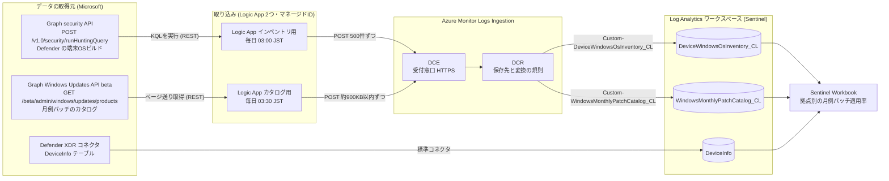
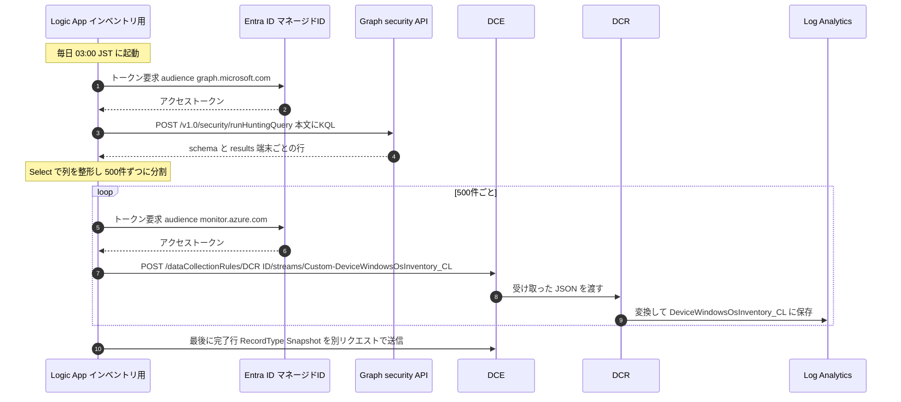
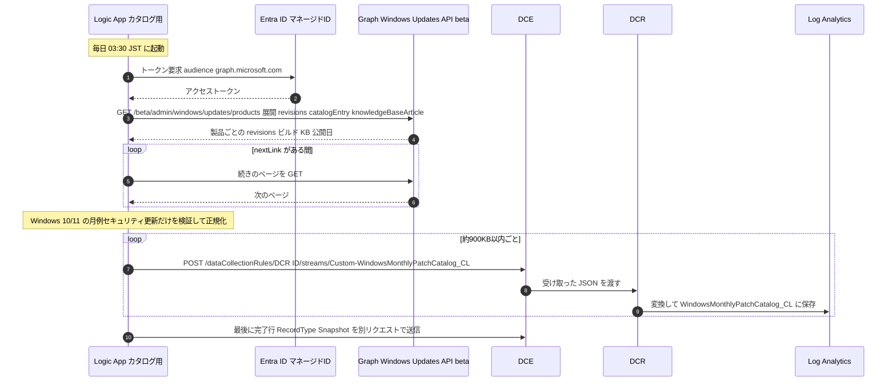
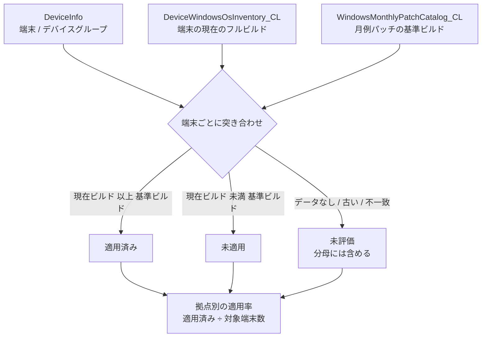

# Microsoft 月次OSパッチ適用状況 Workbook (Windows 10/11)

**行 = 月次OSパッチ、列 = Defender デバイスグループ、セル = 端末台数ベースの適用率**を表示する Sentinel Workbook。
既定は直近6回の公開済み月例更新。すべての行を最新の端末状態で評価し、過去の月末時点の履歴とは区別します。

本READMEは、**Logic App のHTTPアクションから Microsoft Graph API を直接呼び出す方式**を基準とします。

同梱のBicepは、**役割ごとに2つのLogic App** を作成します。それぞれ別のマネージドIDで動作し、必要なGraph権限・実行時刻・実行履歴を分けています。

| Logic App | 役割 | 書き込み先 |
|---|---|---|
| `logic-defender-os-patch-ingest` | **Graph security API v1.0の `runHuntingQuery`** でDefender TVMのWindows 10/11インベントリを取得 | `DeviceWindowsOsInventory_CL` |
| `logic-windows-patch-catalog-ingest` | **Graph betaのWindows Updateカタログ** から月例更新を取得し、ページング・検証・正規化 | `WindowsMonthlyPatchCatalog_CL` |

## 実際の画面イメージ


## 全体像

このリポジトリは、**「Windows 10/11 の端末に、今月の Windows 更新プログラム（月例パッチ）が適用されているか」を、拠点（Defender のデバイスグループ）ごとに Sentinel のブックで見られるようにする**ためのテンプレート一式です。

Workbook を表示するには「端末が今どのビルドか」と「Microsoft が公開した月例パッチのビルドは何か」の2種類のデータが必要です。前者は Defender、後者は Microsoft Graph から取得できますが、そのままでは Log Analytics に入っていません。そこで **Logic App が REST API でデータを取得し、DCE/DCR 経由で Log Analytics のカスタムテーブルに書き込み**ます。

### 作成されるもの（テンプレートの概要）

| テンプレート / スクリプト | 作成・実行されるもの | 役割 |
|---|---|---|
| [ingest/main.bicep](ingest/main.bicep) | Logic App（インベントリ用）、DCE、DCR、カスタムテーブル、DCRへの書き込み権限 | Defender の端末情報を取り込む基盤一式 |
| [ingest/catalog-logic-app.bicep](ingest/catalog-logic-app.bicep) | Logic App（カタログ用）、DCRへの書き込み権限 | Microsoft が公開した月例パッチ情報を取り込む。`main.bicep` から呼ばれ、単独でもデプロイ可能 |
| [ingest/grant-defender-api-permission.ps1](ingest/grant-defender-api-permission.ps1) / [ingest/grant-graph-update-permission.ps1](ingest/grant-graph-update-permission.ps1) | 各 Logic App のマネージドIDへの Graph API 権限 | Graph を呼び出すための許可（Entra 管理者が実行） |
| [YmcOSPatchStatus.arm.json](YmcOSPatchStatus.arm.json) | Sentinel の Workbook | 取り込んだデータを拠点別の適用率として表示 |

作成される Azure リソースと、データの置き場所は次のとおりです。

| 種類 | 名前（既定） | 説明 |
|---|---|---|
| Logic App | `logic-defender-os-patch-ingest` | 毎日 03:00 JST。Defender から端末の OS ビルドを取得 |
| Logic App | `logic-windows-patch-catalog-ingest` | 毎日 03:30 JST。Graph から月例パッチのカタログを取得 |
| DCE（データ収集エンドポイント） | `dce-defender-os-patch` | Log Analytics へデータを送る HTTPS の受付窓口 |
| DCR（データ収集規則） | `dcr-defender-os-patch` | 受け取ったデータをどのテーブルへ、どう変換して保存するかの規則 |
| カスタムテーブル | `DeviceWindowsOsInventory_CL` | 端末ごとの OS ビルド（Defender 由来） |
| カスタムテーブル | `WindowsMonthlyPatchCatalog_CL` | 月例パッチごとの到達ビルド・KB（Graph 由来） |
| Workbook | 月次OSパッチ適用状況 | 上の2テーブルと `DeviceInfo` を突き合わせて表示 |

### 全体の流れ



ポイントは次の3つです。

1. **Logic App は2つに分けています。** Defender 用と Windows Update カタログ用で、実行時刻・必要な権限・実行履歴が別になるため、片方が失敗してももう片方に影響せず、原因の切り分けも簡単です。
2. **パスワードやシークレットは持ちません。** Logic App は自分の **マネージドID**（Azure が管理するID）でトークンを取得して API を呼びます。
3. **DCE と DCR を必ず通ります。** Log Analytics のカスタムテーブルへは、DCE の URL と DCR の ID を指定した Logs Ingestion API の REST 呼び出しで書き込みます。

### DCE と DCR とは

| 用語 | たとえると | このプロジェクトでの役割 |
|---|---|---|
| **DCE** (Data Collection Endpoint) | 荷物の受付窓口 | Logic App が JSON を POST する宛先の URL。Logic App はこの URL とDCR の ID から送信先を組み立てます |
| **DCR** (Data Collection Rule) | 仕分けのルール表 | 送られてきた JSON の列定義（ストリーム宣言）と、保存先テーブル、変換（`source \| extend TimeGenerated = SnapshotTime`）を定義 |
| **マネージドID** | Logic App 専用の社員証 | パスワード無しで Graph と Logs Ingestion API にサインインする |
| **Monitoring Metrics Publisher** | 「この規則に荷物を出してよい」許可 | Logic App のIDに、DCR に対してだけ付与する Azure RBAC ロール |

### Logic App がデータを取り込む流れ

#### ① インベントリ用：Defender の端末OSビルド（毎日 03:00 JST）



1. Logic App が Graph security API に **KQL** を POST します（`DeviceTvmSoftwareInventory` から Windows 10/11 の OS ビルドを取得。KQL と結果例は[後述](#defenderの取得カスタムログ取り込みgraph-security-api)）。
2. 返ってきた `results` を Logic App の `Select` アクションで保存用の列に整形します。
3. 500 行ずつの JSON 配列にして DCE へ POST します。DCR が `TimeGenerated` を付けてテーブルに保存します。
4. **全部送れたときだけ**、最後に「完了行」を送ります。Workbook は完了行のあるスナップショットだけを使うため、途中で失敗したデータが画面に混ざりません。

#### ② カタログ用：Microsoft の月例パッチ情報（毎日 03:30 JST）



1. Logic App が Graph の Windows Update カタログ（`products` → `revisions`）を **ページ送りしながら全件取得**します。
2. Windows 10/11 の月例セキュリティ更新だけを選び、ビルド番号・KB・公開日を検証して、Workbook が使う列（`FullVersion`、`PatchId`、`ReleaseMonth` など）に整形します。
3. データサイズが上限を超えないよう分割して DCE へ POST し、成功したら完了行を送ります。
4. 取得・検証・送信のどこかで失敗した場合は、完了行を送らず Logic App 自体を失敗にします。

#### ③ Workbook での表示

Workbook は、`DeviceInfo`（端末とデバイスグループ）、`DeviceWindowsOsInventory_CL`（端末の現在ビルド）、`WindowsMonthlyPatchCatalog_CL`（月例パッチの到達ビルド）の3つを KQL で突き合わせます。**端末のビルドが、その月の基準ビルド以上なら「適用済み」**として、拠点（デバイスグループ）ごとの適用率を計算します。



### まず試す手順（概要）

1. `ingest/main.bicep` をデプロイします（Logic App は無効状態）。
2. 管理者が `grant-*.ps1` で、各 Logic App のIDに Graph の権限を付与します。
3. Logic App を有効化して手動実行し、2つのカスタムテーブルにデータが入ったことを確認します。
4. `YmcOSPatchStatus.arm.json` で Workbook をデプロイします。

具体的なコマンドは[セットアップ](#セットアップ直接取得方式)を参照してください。

## 判定方法

- 対象は **Windows 10/11のみ**。Windows Serverは対象外です。既定のオンボード状態は `Onboarded`。
- 分母は `DeviceInfo` の過去14日間の端末ごとの最新情報から、拠点・OS・種別・オンボード状態で絞ったWindows端末数。
- Microsoft Graphの製品リビジョン・KB・品質更新カタログから、OS・ビルド系列・公開月ごとの月例セキュリティ更新と到達ビルドを取得します。`qualityUpdateCadence=monthly` かつ `qualityUpdateClassification=security` を月例基準にし、CVE公開月や表示名から推測しません。
- MDE の `DeviceTvmSoftwareInventory.SoftwareVersion` をフルビルド番号として収集。同じOS・ビルド系列で当月の基準リビジョン以上なら適用済みと判定します。後続の累積更新も含みます。
- 現在のフルビルドがGraphの品質更新履歴に存在することも検証します。OS・ビルド系列をまたいで比較しません。Graphに対応情報がない製品や古いビルドは未評価です。
- **適用率 = 確認済み適用台数 ÷ 対象Windows端末数 × 100**。未評価も分母に含めますが、適用済みにはしません。全台未評価のセルは「未評価」と表示します。
- インベントリなし、複数バージョン、`DeviceInfo` とのビルド不一致、未公開・対応不明のビルド、当月基準不明、2日超または未来のスナップショットは未評価です。
- .NET・Office・Defender定義・機能更新・Hotpatch・プレビュー・緊急更新は基準行から除外。通常のプレビュー・緊急累積更新は照合用の既知ビルドとして収集するため、当月のセキュリティ基準を満たせば適用済みです。

これはOSの到達ビルドによる判定です。KBのインストール成功履歴・再起動完了・ESUライセンスの有無を直接検証するものではありません。公開履歴とフルビルドの対応を確認できない製品やサービシング方式は未評価になります。

## 関連ファイル

| ファイル | 内容 |
|---|---|
| [YmcOSPatchStatus.workbook.json](YmcOSPatchStatus.workbook.json) | Workbook 本体 (Advanced Editor > Gallery Template) |
| [YmcOSPatchStatus.arm.json](YmcOSPatchStatus.arm.json) | 既存ワークスペースを既定選択したWorkbookを作成するARMテンプレート |
| [build_workbook.py](build_workbook.py) | 上記2ファイルの生成スクリプト |
| [monthly_queries.py](monthly_queries.py) | 月次適用判定・集計の共通KQL |
| [ingest/main.bicep](ingest/main.bicep) | インベントリ用Logic App・DCE・DCR・カスタムテーブル・取り込み権限と、カタログ用モジュールの呼び出し |
| [ingest/catalog-logic-app.bicep](ingest/catalog-logic-app.bicep) | カタログ用Logic Appと、そのIDのDCR取り込み権限 (単独でもデプロイ可能) |
| [ingest/catalog-actions.json](ingest/catalog-actions.json) | カタログのHTTP取得・ページング・検証・正規化・完了スナップショット送信の定義 |
| [ingest/workspace-table.bicep](ingest/workspace-table.bicep) | 既存ワークスペース内のカスタムテーブル作成 |
| [ingest/grant-defender-api-permission.ps1](ingest/grant-defender-api-permission.ps1) | **インベントリ用** Logic AppのマネージドIDにGraphの `ThreatHunting.Read.All` を付与するスクリプト |
| [ingest/grant-graph-update-permission.ps1](ingest/grant-graph-update-permission.ps1) | **カタログ用** Logic AppのマネージドIDにGraphの `WindowsUpdates.Read.All` を付与するスクリプト |

## アーキテクチャ（役割別の2つのLogic App）

- `DeviceInfo`：XDRコネクタで収集する端末・デバイスグループ情報。
- `DeviceWindowsOsInventory_CL`：インベントリ用Logic Appが毎日03:00 JSTにGraph security APIでDefender Advanced Huntingを実行し、Windows 10/11のOSインベントリを取得。
- `WindowsMonthlyPatchCatalog_CL`：カタログ用Logic Appが毎日03:30 JSTにGraphの `products` → `revisions` → `catalogEntry` / `knowledgeBaseArticle` を直接取得。
- 各Logic Appが取得結果を既存の列形式に正規化し、Logs Ingestion APIでDCE/DCRを通して自分のテーブルへ送信します。
- Workbookは `DeviceInfo` と、各カスタムテーブルの最後に完了したスナップショットを使って表示します。

2つは互いに依存しません。一方が失敗しても、もう一方の実行・完了スナップショットは影響を受けず、Workbookは各テーブルの完了済みスナップショットだけを使います。実行時刻は `runHourJst` / `catalogRunHourJst` / `catalogRunMinuteJst` で変更できます。

### 認証・必要な権限

HTTPアクションの認証はすべて **Managed identity / System-assigned managed identity** とし、呼び出し先ごとにAudienceを指定します。クライアントシークレットや固定トークンをワークフローに保存しません。

| Logic App | 呼び出し先 | Audience | マネージドIDに必要な権限 |
|---|---|---|---|
| インベントリ用 | Defender Advanced Hunting (Graph security API v1.0) | `https://graph.microsoft.com/` | Microsoft Graphのアプリケーション権限 `ThreatHunting.Read.All` |
| インベントリ用 | Logs Ingestion API | `https://monitor.azure.com` | 対象DCRに対するAzure RBAC `Monitoring Metrics Publisher` |
| カタログ用 | Windows Updateカタログ (Graph beta API) | `https://graph.microsoft.com` | Microsoft Graphのアプリケーション権限 `WindowsUpdates.Read.All` |
| カタログ用 | Logs Ingestion API | `https://monitor.azure.com` | 対象DCRに対するAzure RBAC `Monitoring Metrics Publisher` |

各IDには自分の用途の権限だけを付与します。Graphのアプリケーション権限はAzure RBACとは別に、Entra管理者が付与します。収集処理にGraphの書き込み権限は不要です。
マネージドIDの権限変更は、Azure側のトークンキャッシュにより反映まで時間がかかる場合があります。

### Defenderの取得・カスタムログ取り込み（Graph security API）

Defenderから取得するのは、**端末に現在インストールされているWindows 10/11のOSインベントリ**です。`DeviceTvmSoftwareInventory` の `SoftwareVersion` をフルビルドとして収集し、Graphの月例基準と照合します。KBの適用成功履歴や再起動完了を取得するものではありません。

#### 実行するKQL

```kusto
DeviceTvmSoftwareInventory
| where SoftwareVendor =~ "microsoft"
| where SoftwareName matches regex "^windows_(10|11)$"
| project DeviceId, DeviceName, OSPlatform, SoftwareName, SoftwareVersion, OSVersion,
          OSArchitecture, ProductCodeCpe, RecordType = "Device"
```

- Microsoft製品のうち、ソフトウェア名が `windows_10` または `windows_11` の行だけを取得します。Windows Server・Office・.NETなどは対象外です。
- `SoftwareVersion` などの返却値は書き換えずに保存し、`RecordType=Device` をKQLで付与します。フルビルドとして解釈できない値は、Workbookで未評価にします。
- このKQLでは端末単位の集約やデバイスグループ・オンボード状態による絞り込みはしません。同じ端末に複数のインベントリ行があればそのまま収集し、Workbook側で複数バージョンなどの整合性を検証します。
- 対象端末・拠点の絞り込みには、Workbook側でXDRコネクタの `DeviceInfo` を使います。

列の意味は [DeviceTvmSoftwareInventoryの公式スキーマ](https://learn.microsoft.com/defender-xdr/advanced-hunting-devicetvmsoftwareinventory-table) を参照してください。

#### APIリクエストと応答例

Logic AppのHTTPアクションでマネージドID認証を使用し、上記KQLをJSON本文の `Query` に設定します。Audienceは `https://graph.microsoft.com/`、アプリケーション権限は `ThreatHunting.Read.All` です。

```http
POST https://graph.microsoft.com/v1.0/security/runHuntingQuery
Content-Type: application/json
```

```json
{
  "Query": "DeviceTvmSoftwareInventory\n| where SoftwareVendor =~ \"microsoft\"\n| where SoftwareName matches regex \"^windows_(10|11)$\"\n| project DeviceId, DeviceName, OSPlatform, SoftwareName, SoftwareVersion, OSVersion,\n          OSArchitecture, ProductCodeCpe, RecordType = \"Device\""
}
```

成功時はHTTP 200と、列定義の `schema`・結果行の `results` が返ります。これらのキーと列定義内の `name` / `type` は小文字ですが、各結果行の列名はKQLの出力どおりの大文字・小文字を維持します。

次は端末1台分に省略した説明用サンプルで、実際の端末情報やAPI取得ログではありません。ビルドは後述のカタログの例と対応させています。`OSVersion` などの表記は実際の返却値に従い、CPE情報がない場合の `ProductCodeCpe` は `not available` です。

```json
{
  "schema": [
    { "name": "DeviceId", "type": "String" },
    { "name": "DeviceName", "type": "String" },
    { "name": "OSPlatform", "type": "String" },
    { "name": "SoftwareName", "type": "String" },
    { "name": "SoftwareVersion", "type": "String" },
    { "name": "OSVersion", "type": "String" },
    { "name": "OSArchitecture", "type": "String" },
    { "name": "ProductCodeCpe", "type": "String" },
    { "name": "RecordType", "type": "String" }
  ],
  "results": [
    {
      "DeviceId": "1111111111111111111111111111111111111111",
      "DeviceName": "pc-001.example.com",
      "OSPlatform": "Windows11",
      "SoftwareName": "windows_11",
      "SoftwareVersion": "10.0.22621.2134",
      "OSVersion": "10.0.22621.2134",
      "OSArchitecture": "x64",
      "ProductCodeCpe": "not available",
      "RecordType": "Device"
    }
  ]
}
```

APIの詳細は [runHuntingQueryの公式仕様](https://learn.microsoft.com/graph/api/security-security-runhuntingquery?view=graph-rest-v1.0) を参照してください。Windows Updateカタログの取得とは別のAPI呼び出しで、必要な権限も異なります。

#### カスタムログへ送るデータの例

Logic Appの `Select` アクションで `body('Run_Advanced_Hunting')?['results']` を読み、各行に次の2項目を追加します。`schema` などのAPIメタデータは取り込みません。

| 追加項目 | 設定値 | 用途 |
|---|---|---|
| `SnapshotId` | `workflow().run.name` | 同じ収集実行のデータ行・完了行を識別 |
| `SnapshotTime` | 収集開始時に1回取得した `utcNow()` | 全行で共通の収集開始時刻 (UTC) |

`SnapshotTime` は、端末の最終観測時刻やKBのインストール日時ではありません。

次のJSON配列をLogs Ingestion APIへ送ります。ID・時刻は説明用です。APIが返した9列はそのまま保持します。

```http
POST {logIngestionEndpoint}/dataCollectionRules/{dcrImmutableId}/streams/Custom-DeviceWindowsOsInventory_CL?api-version=2023-01-01
Content-Type: application/json
```

```json
[
  {
    "SnapshotId": "example-inventory-20261105",
    "SnapshotTime": "2026-11-04T18:00:00Z",
    "RecordType": "Device",
    "DeviceId": "1111111111111111111111111111111111111111",
    "DeviceName": "pc-001.example.com",
    "OSPlatform": "Windows11",
    "SoftwareName": "windows_11",
    "SoftwareVersion": "10.0.22621.2134",
    "OSVersion": "10.0.22621.2134",
    "OSArchitecture": "x64",
    "ProductCodeCpe": "not available"
  }
]
```

送信は500行単位で分割し、各バッチを順にPOSTします。件数だけではリクエストのバイト数上限を保証できないため、ペイロードサイズにも注意します。認証のAudienceは `https://monitor.azure.com` です。DCRでは次の変換を行い、`DeviceWindowsOsInventory_CL` に保存します。

```kusto
source | extend TimeGenerated = SnapshotTime
```

したがって、実際のログには送信JSONの列に加えて `TimeGenerated` が入り、この例では `2026-11-04T18:00:00Z` になります。

全バッチの送信成功後に、同じ送信先へ次の完了行を**別リクエスト**で送ります。データ送信が失敗した場合は、この行を送信しません。

```json
[
  {
    "SnapshotId": "example-inventory-20261105",
    "SnapshotTime": "2026-11-04T18:00:00Z",
    "RecordType": "Snapshot",
    "DeviceId": "",
    "DeviceName": "",
    "OSPlatform": "",
    "SoftwareName": "",
    "SoftwareVersion": "",
    "OSVersion": "",
    "OSArchitecture": "",
    "ProductCodeCpe": ""
  }
]
```

Workbookは最後の完了行と同じ `SnapshotId` の `Device` 行だけを使います。完了行は端末として数えません。この例の端末は、その他の検証条件も満たせば、カタログの例にある2023年8月の基準ビルド `10.0.22621.2134` に到達済みと判定します。

### Windows Updateカタログの取得・正規化

最初のHTTPアクションは、本文なしの `GET` で次のURLを呼び出します。

```http
GET https://graph.microsoft.com/beta/admin/windows/updates/products?$expand=revisions($expand=catalogEntry,knowledgeBaseArticle)
```

#### 取得レスポンスの例

Graphから取得するのは、**Microsoftが公開した更新の「対象OS・バージョン、公開日、到達ビルド、KB、更新分類」などのカタログ情報**です。端末ごとのインストール済みKB一覧や適用成功履歴ではありません。端末の現在のビルドはDefenderから別途取得し、このカタログと照合します。

以下は返却形式を示す説明用サンプルです。ビルド・KB・公開日は、[Microsoft公式の公開例](https://learn.microsoft.com/windows/deployment/windows-autopatch/manage/windows-autopatch-windows-quality-update-programmatic-controls#list-catalog-entries-for-expedited-updates) にある2023年8月の更新に基づき、本READMEの `products → revisions` の構造に整理しています。実取得ログや最新の更新を示すものではありません。製品・リビジョンは1件ずつとし、ID・メタデータ・ページング情報などは省略しています。

```json
{
  "value": [
    {
      "name": "Windows 11, version 22H2",
      "groupName": "Windows 11",
      "revisions": [
        {
          "product": "Windows 11",
          "version": "22H2",
          "releaseDateTime": "2023-08-08T00:00:00Z",
          "isHotpatchUpdate": false,
          "osBuild": {
            "majorVersion": 10,
            "minorVersion": 0,
            "buildNumber": 22621,
            "updateBuildRevision": 2134
          },
          "knowledgeBaseArticle": {
            "id": "KB5029263",
            "url": "https://support.microsoft.com/help/5029263"
          },
          "catalogEntry": {
            "@odata.type": "#microsoft.graph.windowsUpdates.qualityUpdateCatalogEntry",
            "releaseDateTime": "2023-08-08T00:00:00Z",
            "qualityUpdateCadence": "monthly",
            "qualityUpdateClassification": "security"
          }
        }
      ]
    }
  ]
}
```

| 取得項目 | この例で分かること | Workbookでの用途 |
|---|---|---|
| 製品の `groupName` / `name`、リビジョンの `product` / `version` | Windows 11、バージョン22H2向けの更新 | 対象OSの選別・整合性確認。ビルド比較はバージョン名ではなく `osBuild` で行う |
| `osBuild` の4要素 | 到達ビルドは `10.0.22621.2134` | 同じビルド系列の端末が、この更新の基準リビジョンに達したかを判定 |
| リビジョンと `catalogEntry` の `releaseDateTime` | 2023年8月8日公開 | 更新の公開日と月例基準の公開月を決定 |
| `qualityUpdateCadence` / `qualityUpdateClassification` | `monthly` / `security` | 月例セキュリティ更新として `ReleaseKind=B` に分類 |
| `knowledgeBaseArticle.id` / `url` | KB5029263と公式記事URL | 月例KB・対象ビルドの表示、公式KBへのリンク |
| `isHotpatchUpdate` | `false` | Hotpatchを基準・照合対象から除外するための確認 |

#### 正規化ルール

直接取得のワークフローは、次の処理を行います。

1. 製品一覧の `@odata.nextLink` と、各製品の `revisions@odata.nextLink` をそれぞれ `Until` で追跡します。展開済みの `revisions` だけでは全件取得とは限りません。続きのページでは `value` 配列を処理します。
2. ページング先はGraphのHTTPS URLかつ `/beta/admin/windows/updates/` 配下のみ許可し、URLの循環・配列や型の不正を失敗にします。`Until` の回数・時間上限を設定し、終了後もnextLinkが残っていれば失敗にします。共有変数を更新する製品ループは同時実行数1にします。
3. Windows 10/11の品質更新を対象にし、Windows Server・機能更新・Hotpatch・未来の公開分を除外します。品質更新の分類、OS系列、4要素の `osBuild`、公開日時、KB番号・公式KB URLを検証し、未知の値や不整合を推測で補完しません。
4. `qualityUpdateCadence=monthly` かつ `qualityUpdateClassification=security` を `ReleaseKind=B` とします。通常のプレビューは `Preview`、緊急更新は `OOB`、月次の `all` は `Other` として照合用に保持します。月例基準行には `B` だけを使います。
5. `Family`・`FullVersion`・`ReleaseDate`・`PatchId`・`ReleaseKind` の組で重複を除去し、Windows 10/11それぞれに異なる公開月の `B` が6か月分以上あることを検証します。既定表示が6回でも、照合用カタログを直近6件に切り詰めません。

同じキーの行でKB URLなどの内容が矛盾する場合も失敗させます。日時はUTCの `Z` / `+00:00` 形式を検証し、型・更新分類・公開月を推測で補完しません。KB番号・公式KBのHTTPS URLは専用のフィルターで検証し、Parse JSONで非対応の正規表現スキーマは使用しません。

カタログ行は次の列名・型・値で作成し、カスタムテーブルとDCRのストリーム宣言も同じ定義にします。

| 保存列 | 型 | 値 |
|---|---|---|
| `SnapshotId` / `SnapshotTime` | `string` / `datetime` | 収集単位のID / 開始時刻 (UTC)。同じカタログの全行で共通 |
| `RecordType` | `string` | 更新ビルド行は `Build` |
| `Family` | `string` | `Windows10` または `Windows11` |
| `BaseVersion` / `FullVersion` | いずれも `string` | `osBuild` の先頭3要素 / 全4要素を `.` で連結 |
| `Revision` | `long` | `osBuild.updateBuildRevision` |
| `ReleaseMonth` / `ReleaseDate` | いずれも `datetime` | `catalogEntry.releaseDateTime` のUTC月初 / リビジョンの `releaseDateTime` |
| `PatchId` / `ReleaseKind` / `SourceUrl` | いずれも `string` | `KB` 付きのKB番号 / 上記分類 / `knowledgeBaseArticle.url` |

#### 保存データと適用判定の例

上記のリビジョンは、`WindowsMonthlyPatchCatalog_CL` に次の1行として保存します。`SnapshotId` / `SnapshotTime` はGraphの返却値ではなく、Logic Appが収集時に付与する値です。この例の収集ID・時刻も説明用であり、実際には収集単位ごとのID・開始時刻を使用します。古い公開日の更新を収集する場合も、収集時刻には実際の開始時刻を設定します。

```json
{
  "SnapshotId": "example-snapshot-20261105",
  "SnapshotTime": "2026-11-04T18:00:00Z",
  "RecordType": "Build",
  "Family": "Windows11",
  "BaseVersion": "10.0.22621",
  "FullVersion": "10.0.22621.2134",
  "Revision": 2134,
  "ReleaseMonth": "2023-08-01T00:00:00+00:00",
  "ReleaseDate": "2023-08-08T00:00:00+00:00",
  "PatchId": "KB5029263",
  "ReleaseKind": "B",
  "SourceUrl": "https://support.microsoft.com/help/5029263"
}
```

この行は「Windows 11の `10.0.22621` 系列では、2023年8月の月例基準がリビジョン `2134`」という意味です。インベントリ・鮮度などの検証を満たす端末のフルビルドが `10.0.22621.2134` なら、この月例更新は適用済みと判定します。同じ系列の後続ビルドも、Graphに掲載された既知ビルドであれば適用済みです。別系列のビルドやGraph未掲載のビルドを、数値が大きいだけで適用済みにはしません。

### 送信・完了判定

- 正規化した行をJSON配列にし、ペイロード上限を超えないサイズで分割して `POST {logIngestionEndpoint}/dataCollectionRules/{dcrImmutableId}/streams/{streamName}?api-version=2023-01-01` へ送信します。件数だけの分割ではバイト数上限を保証できません。
- ストリームはインベントリ用の `Custom-DeviceWindowsOsInventory_CL` と、カタログ用の `Custom-WindowsMonthlyPatchCatalog_CL` を使います。
- **テーブルごとに、検証と全データ行の送信が成功した後だけ**、同じ `SnapshotId` / `SnapshotTime` の `RecordType=Snapshot` 行を別リクエストで送ります。カタログの完了行では文字列列を空文字、`Revision` を0、`ReleaseMonth` / `ReleaseDate` をnullとし、既存形式を維持します。
- 429・一時的な5xxには上限付きの再試行を設定し、`Retry-After` に従います。取得・検証・送信が最終的に失敗した場合は、失敗したデータセットの完了行を送らず、`Scope` / `runAfter` と `Terminate (Failed)` でLogic App自体も失敗させます。HTML取得への自動フォールバックはしません。
- ページ取得に失敗した場合はエラー状態を保持してループを停止します。ページングURLを空にして終了させた場合も、エラー状態があれば完了検証を失敗させるため、正常な全件取得とは扱いません。
- 完了判定はテーブル単位で、Logic Appも分かれています。片方が失敗しても、もう一方の完了スナップショットは書き込まれます。Workbookは未完了データを混ぜず、前回の完了値も鮮度検証の対象とし、無条件に最新・適用済みとは扱いません。

TVMテーブルは通常のXDRコネクタでは取り込まれないため、API経由で収集します ([公式説明](https://learn.microsoft.com/azure/sentinel/microsoft-365-defender-sentinel-integration))。
Graph仕様：[製品](https://learn.microsoft.com/graph/api/resources/windowsupdates-product?view=graph-rest-beta)、[製品リビジョン](https://learn.microsoft.com/graph/api/resources/windowsupdates-productrevision?view=graph-rest-beta)、[品質更新カタログ](https://learn.microsoft.com/graph/api/resources/windowsupdates-qualityupdatecatalogentry?view=graph-rest-beta)。
Logic Apps仕様：[マネージドID認証](https://learn.microsoft.com/azure/logic-apps/authenticate-with-managed-identity)、[Graphのページング](https://learn.microsoft.com/graph/paging)、[Graphのスロットリング](https://learn.microsoft.com/graph/throttling)。
**Windows Updateカタログの取得に使用するGraph APIはbeta版です。仕様変更の可能性があり、実稼働アプリケーションでの利用はサポート対象外です。** OSインベントリの取得に使うGraph security APIはv1.0です。

旧 `DeviceTvmOsPatch_CL` と移行前のWindows Server履歴は削除しませんが、新しいWindows 10/11の判定には使いません。テーブル名と列形式は移行前と同じです。

## セットアップ（直接取得方式）

事前に `az account show` でサブスクリプションを確認してください。既存ワークスペースと取り込み用リソースグループは同じサブスクリプションが前提です。
PowerShell 7・Azure CLIと、Graph権限付与用の `Microsoft.Graph.Applications` モジュールを使用します。両RGへのデプロイ権限、DCRへのロール割り当て権限、Logic Appの編集権限、Graphのアプリケーション権限を付与できるEntra管理者権限が必要です。

1. 初回は、2つのLogic Appを無効状態でデプロイします。既存ワークスペースは作成しません。

   ```powershell
   $outputs = az deployment group create `
     -g <取り込み用RG> `
     -f .\ingest\main.bicep `
     -p workspaceName=<ワークスペース名> `
        workspaceResourceGroupName=<ワークスペースのRG> `
        dataCollectionLocation=<ワークスペースと同じリージョン> `
        enableIngestion=false `
     --query properties.outputs --output json | ConvertFrom-Json
   if ($LASTEXITCODE -ne 0) { throw 'デプロイに失敗しました。' }
   ```

   リソース名・RG・リージョンは環境に合わせて変更してください。DCE/DCRの名前は既定で `dce-defender-os-patch` / `dcr-defender-os-patch` で、`dceName` / `dcrName` で変更できます。既存リソースを更新する場合は、**既存と同じ名前を必ず指定**してください（既定名と異なる名前のDCEが既にあるとき、指定しないと別のDCEが作成されます）。Logic Appの名前は `logicAppName` (インベントリ用)・`catalogLogicAppName` (カタログ用) で変更できます。DCE/DCRはワークスペースと同じリージョンに作成し、`TimeGenerated` には `SnapshotTime` を設定します。
   既存のDCE/DCRをそのまま使う場合は、カタログ用だけを単独でデプロイできます。

   ```powershell
   az deployment group create -g <取り込み用RG> `
     -f .\ingest\catalog-logic-app.bicep `
     -p dceName=<既存DCE名> dcrName=<既存DCR名> enabled=false
   ```

2. 初回および従来APIからの移行時に、**インベントリ用** Logic AppのマネージドIDへ Microsoft Graph の `ThreatHunting.Read.All` を付与します。
   従来APIの権限だけではGraph版を呼び出せません。Graph権限が付与済みならスクリプトは変更せず終了します。他の権限や既存の割り当ては削除しません。Defender XDRコネクタの `DeviceInfo` 収集も有効にしてください。

   ```powershell
   $logicAppPrincipalId = $outputs.logicAppPrincipalId.value
   .\ingest\grant-defender-api-permission.ps1 `
     -LogicAppPrincipalId $logicAppPrincipalId
   ```

3. Entra管理者がMicrosoft Graphのアプリロール割り当てで、**カタログ用Logic AppのマネージドID** に `WindowsUpdates.Read.All` のアプリケーション権限を付与します。

   ```powershell
   .\ingest\grant-graph-update-permission.ps1 `
     -SubscriptionId (az account show --query id --output tsv) `
     -LogicAppPrincipalId $outputs.catalogLogicAppPrincipalId.value
   ```

   対象DCRのAzure RBAC `Monitoring Metrics Publisher` はBicepが各Logic AppのIDに付与します。

4. 無効状態の2つのLogic Appで、それぞれのGraph権限と送信先を確認します。HTTPアクション・ページング・検証・取り込みの定義は同梱済みで、手動で追加する必要はありません。`CatalogIngestionUri` はBicepがDCEのエンドポイントとDCRのimmutable IDから設定します。

5. 2つのLogic Appを有効化し、それぞれポータルから初回実行します。実行履歴でGraphのHTTP呼び出しとLogs Ingestion APIへの送信成功を確認します。初回のLog Analytics反映には時間がかかるため、両テーブルの `Snapshot` 行も確認してください。以降はインベントリ用が毎日03:00 JST、カタログ用が毎日03:30 JSTに実行します。
   Logic Appのアクション実行・Log Analyticsへの取り込み等には利用量に応じた料金が発生します。

6. `python .\build_workbook.py` で生成し、Workbookを取り込みます。ARMで配置する場合は `workbookSourceId` に既存ワークスペースのリソースIDを指定します。
   `workbookId` の既定値はワークスペースから決まる固定GUIDのため、再デプロイでは同じWorkbookを更新します。別の既存Workbookを更新する場合は、その `workbookId` を明示指定してください。

## タブ

| タブ | 内容 |
|---|---|
| 月次OSパッチ適用率 | 月次更新 × デバイスグループの適用率、選択月の台数、収集状態 |
| 台数内訳 | 未評価台数マトリクス、月×グループの対象・適用済み・未適用・未評価・評価済み率 |
| 月別グラフ | 各月の更新を最新状態で評価した適用率の折れ線 |
| 月例KB・対象ビルド | 選択月のMicrosoft公式KB・基準ビルド |
| 端末別更新状況 | 全対象端末のDeviceInfoビルド、最新の到達済み月次パッチ・KB、比較対象月の状況 |
| Windows OSビルド | フルビルド分布・インベントリ検証 |
| データ診断 | 元データ・完了スナップショット・カタログの収集範囲 |

### 端末別更新状況の判定

- 適用済みも含む全対象端末を、端末ごとに1行表示します。対象端末・フィルターはマトリクスと同じです。
- 過去14日間の最新 `DeviceInfo` の `OSVersion` + `OSBuild` + `OsBuildRevision` からフルビルドを作成します (例：`10.0` + `26200` + `9711` → `10.0.26200.9711`)。この一覧ではTVMインベントリで補完しません。
- 同じOS・ビルド系列のGraph月例セキュリティ基準のうち、現在のリビジョン以下となる最新の公開月・KB・基準ビルドを表示します。比較対象月や表示月数では上限・下限を設けず、取得済みカタログ全体を確認します。
- プレビュー・緊急更新のビルドは、それ以前の月例基準を満たせば到達済みとします。それらのKBを月例KBとして表示することはありません。
- フルビルド不明、Graph未掲載、未来のDeviceInfo、期限切れカタログは未評価です。既知のビルドでも満たす月例基準がなければ「該当する月例更新なし」と表示し、任意の月を推測しません。
- 「確認する月次パッチ」で選んだ比較対象月の基準に対する状況も表示します。到達済み月次パッチは比較対象月で打ち切りません。
- 既存の適用率マトリクス・台数集計は引き続きTVMのフルビルドで判定し、計算方法は変更しません。DeviceInfoとTVMの更新時刻が異なる場合は一覧との差が出るため、最終確認日時・インベントリ検証を確認してください。

## 表示性能

端末台数と、検索するログ行数・APIリクエスト数は別です。測定時は対象8台に対して、過去14日の `DeviceInfo` は約7,500行・40端末IDありました。
API測定ではマトリクス初回約21.7秒に対してCPUは約0.8秒、わずか7行の単純集計でも約21.2秒に対してCPU約0.03秒でした。計算量だけでなく、サービス側の読み取り・待ち時間や通信等の固定費が大きいため、重複した問い合わせを減らしています。

- 4つの端末フィルター（拠点・OS・オンボード状態・デバイス種別）の候補は、それぞれ `value`/`label` を返す専用のLogsクエリで取得します。ドロップダウンに実際の値が一覧表示され、「すべて」だけに見える状態を避けるためです。既定の `Onboarded`・全選択の意味は変えていません。
- すべてのタブを `loadType: lazy` のグループにし、未表示タブのクエリを初期作成しません。
- 初期表示はマトリクス・台数カード・収集状態に絞り、グラフと未評価台数マトリクスは各専用タブに移動しました。
- 初期表示のLogsクエリ実行数は、表示用3本＋フィルター候補4本＋対象月候補1本の計8本です。従来の定義には表示14本＋候補5本の計19本ありました。Workspace選択用Resource Graphは別です。編集モードやタブを追加表示した後は、実行本数が増えます。
- `DeviceInfo` は必要列だけに絞ってから最新行を取得します。ただしOS・オンボード状態等の絞り込みは最新行の決定後に行い、過去の状態を現在の対象台数に混ぜません。
- 完了スナップショットのID・時刻は1つのスカラー取得にまとめ、小さい公開ビルド対応表の照合には `lookup` を使用します。古い計算結果を長期間保存するキャッシュは追加していません。
- `materialize()` も実測しましたが、応答時間が悪化するケースがあったため採用していません。CPUの削減だけをもって表示が速くなったとは判断していません。
- 対象月に依存しない表示から `{MonthSel}` 参照を除き、詳細月変更による不要な再問い合わせを防ぎます。

適用判定、対象期間、後続累積更新の扱い、未評価を分母に含める規則は変更していません。
Azure Logs側の負荷・データの温まり具合・ネットワークでも応答時間は変動するため、端末が少なくても常に即時応答するとは限りません。

同一データに対して旧版・改修版を交互に各3回実行したAPI比較では、マトリクスの中央値は **77.2秒 → 27.6秒**、スキャン行数は約18,430行 → 16,412行でした。結果のハッシュは全回一致しています。
比較時は `Cache-Control: no-cache` と実行ごとのコメントで単純な結果キャッシュの影響を避けています。
ただし旧版54～89秒、改修版8～52秒と変動があり、これはPortal画面全体の表示時間や応答保証を示すものではありません。

## 検証

### 直接取得ワークフロー

- インベントリ用Logic Appの実行履歴で、Graph security APIの `runHuntingQuery` がHTTP 200を返し、`results` の行がインベントリ送信に渡っていることを確認します。移行後もKQL・保存列・月次適用判定は変更しません。
- カタログ用Logic Appの実行履歴で、GraphへのHTTP認証、製品・リビジョン双方の最終ページ到達、Windows 10/11それぞれの月例基準6か月分以上、全バッチ送信と最後の完了行送信を確認します。
- Workbookの「データ診断」で `DeviceWindowsOsInventory_CL` と `WindowsMonthlyPatchCatalog_CL` の完了スナップショット・収集範囲を確認します。未来または2日超のスナップショットを有効データとして扱わないことも確認します。
- テスト用ワークフローでHTTP失敗・不正なGraph応答・ページング上限到達を検証し、Logic Appが失敗状態になり、失敗したデータセットの新しい完了行が作られないことを確認します。過去の完了行が残っているだけでは今回成功の証拠になりません。

### Workbook・KQL

```powershell
python .\build_workbook.py
```

```powershell
python -m unittest test_monthly_report -v
```

これらはWorkbookの生成物・KQLと、Graph権限付与スクリプトのモック検証です。カタログのネイティブアクションは `python -m unittest test_catalog_workflow -v` でも検証できます。取り込みテンプレートのテストは `YMC_COMPILED_TEMPLATE` に `ingest/main.bicep` のコンパイル済みARM JSONのパスを指定した場合に実行し、2つのLogic Appの分離・権限・アクション構成を検証します。実際のGraph認証やデータ取得を保証するものではないため、直接取得ワークフローは上記の実行履歴・実データでも検証してください。

実際のLog AnalyticsでのKQL境界条件テストは `YMC_TEST_WORKSPACE_ID` と短期の `YMC_LOG_ANALYTICS_TOKEN` をプロセス環境変数で指定したときだけ実行します。トークンをファイルやソースに保存しないでください。
